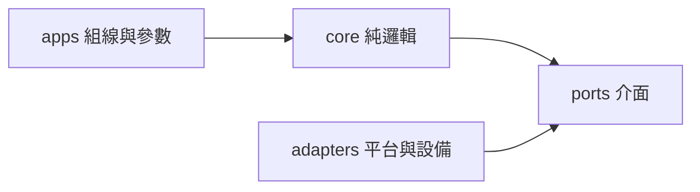

# taiseia-bridge

[English](README.md)

以可攜 C99 實作 TaiSEIA 101 家電連線，北向介面為 MQTT。程式扮演請求端 HNA，
目前沒有連接實體家電的驗證紀錄，也不主張 CNS 16014／16090 符合性或認證。

## 快速開始

```sh
cmake -B build -DCMAKE_BUILD_TYPE=Debug
cmake --build build
ctest --test-dir build --output-on-failure
./build/taiseia-bridge --link sim -c examples/config/simulator.conf
```

需要 C 編譯器。主要開發機沒有編譯器，C 建置與測試由 GitHub Actions 執行。
Windows 多組態建置請使用 `--config Debug` 與 `ctest -C Debug`。

## 論文 lab

Python 實驗與正式 C 執行程式分開。安裝腳本搜尋本機 Python，讓使用者選擇後建立 `.venv`：

```powershell
.\scripts\install.ps1
.\.venv\Scripts\python.exe -m lab.run --output out/r21
```

Linux 使用 `sh scripts/install` 與 `.venv/bin/python`。
本機無 C 編譯器／CBMC 時，結果會明列 C 與證明未執行。完整 CI 驗收使用 `--require-full`。

詳見 [R21 論文與實作對照](lab/docs/paper-r21.md)、[重現步驟](lab/docs/reproduce.md)
與 [實驗目錄](lab/README.md)。新增 metadata 介面是 lab 研究實作，未接上正式 MQTT／CLI。

## 架構與限制



core／ports 不依賴平台 I/O、動態配置或執行緒。能力在註冊時查詢，不內建家電服務表；
一般資料型式不帶值的型別，原始值的語意由使用者自己的規格解釋。

[架構](docs/architecture.md) · [測試](docs/testing.md) · [貢獻規範](CONTRIBUTING.md)
· [Apache-2.0 授權](LICENSE)
