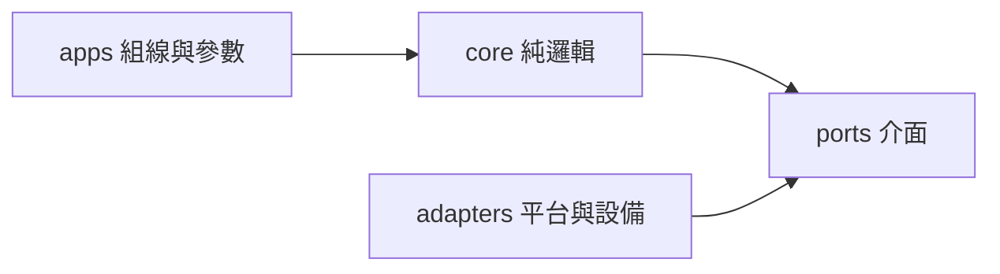

# taiseia-bridge

[English](README.md)

> 本文是英文 [README.md](README.md) 的摘要版。兩者不一致時以英文版為準。

以可攜 C99 實作 TaiSEIA 101（CNS 16014）家電連線，北向介面為 MQTT。程式扮演
標準中的請求端 HNA：經點對點 UART 連線讀取智慧家電（SA）的能力與運轉狀態、接受
控制指令，並發布到 MQTT broker。執行期不依賴外部函式庫，目標平台為 Linux、
Windows 與嵌入式 Linux。

## 現況

**本專案從未連接過實體家電。** 驗證來自 CI（Linux ASan＋UBSan、Linux release、
MSVC）、以真實封包編解碼的模擬器、兩平台的真實 loopback socket、POSIX 的真實
序列裝置，以及真實 MQTT broker。這些都不是對實體家電行為的證據。

- **Windows 序列 adapter 從未在測試中傳送過任何位元組**：虛擬 COM 對需要 hosted
  CI runner 無法安裝的核心驅動。參數檢查與失敗路徑有在 Windows 上執行；完整交換
  已撰寫，未指定實體 COM 對時會跳過。見 [testing.md](docs/testing.md)。
- **MQTT 為明文傳輸**，沒有 TLS 後端；設定 `tls_enable = true` 會拒絕啟動而非降級。
  見 [SECURITY.md](SECURITY.md) 與 [ADR 0008](docs/adr/0008-no-tls.md)。
- 一般型式的型別化 codec 已實作並窮舉測試，證明在 CI 執行，但正式程式尚未呼叫它
  （[ADR 0014](docs/adr/0014-typed-general-data-field.md) 仍為提案）。

完整狀態表見英文 README。本專案不主張 CNS 16014／16090 符合性或認證。

## 快速開始

```sh
cmake -B build -DCMAKE_BUILD_TYPE=Debug
cmake --build build
ctest --test-dir build --output-on-failure
./build/taiseia-bridge --link sim -c examples/config/simulator.conf
```

需要 C 編譯器。主要開發機沒有編譯器，C 建置與測試由 GitHub Actions 執行。
Windows 多組態建置請使用 `--config Debug` 與 `ctest -C Debug`，執行檔位於 `build\Debug\`。

連接實體家電與 broker 時使用 `examples/config/appliance.conf`，至少設定
`serial_port`、`mqtt_host` 與 `device_id`；其餘欄位在檔內有說明。

## 論文 lab

Python 實驗與正式 C 執行程式分開。安裝腳本搜尋本機 Python，讓使用者選擇後建立 `.venv`：

```powershell
.\scripts\install.ps1
.\.venv\Scripts\python.exe -m lab.run --output out/r21
```

Linux 使用 `sh scripts/install` 與 `.venv/bin/python`。
本機無 C 編譯器／CBMC 時，結果會明列 C 與證明未執行。完整 CI 驗收使用 `--require-full`。

詳見 [R21 論文與實作對照](lab/docs/paper-r21.md)、[重現步驟](lab/docs/reproduce.md)
與 [實驗目錄](lab/README.md)。新增 metadata 介面是 lab 研究實作，未接上正式 MQTT／CLI。

## 架構與限制



core／ports 不依賴平台 I/O、動態配置或執行緒。能力在註冊時查詢，不內建家電服務表
（CNS 16014 附錄 A 為授權內容，見 [ADR 0003](docs/adr/0003-no-service-tables.md)）；
一般資料型式不帶值的型別，原始值的語意由使用者自己的規格解釋。

## 文件

| | |
|---|---|
| [docs/architecture.md](docs/architecture.md) | 分層、兩個接縫、為何並行不在 core |
| [docs/mqtt-api.md](docs/mqtt-api.md) | topic 樣板與 payload 格式 |
| [docs/porting.md](docs/porting.md) | 新增平台、協定或並行模型 |
| [docs/testing.md](docs/testing.md) | 已驗證與未驗證的範圍 |
| [docs/verification.md](docs/verification.md) | 三種強度的主張，以及實際成立的部分 |
| [lab/](lab/README.md) | 預期值，以及其中屬於決策而非事實的部分 |
| [docs/adr/](docs/adr) | 設計決策與被否決的替代方案 |
| [CONTRIBUTING.md](CONTRIBUTING.md) | 風格、測試、pull request |
| [SECURITY.md](SECURITY.md) | 回報管道與已接受的限制 |

表中文件皆為英文；R21 對照為中文。授權：[Apache-2.0](LICENSE)，見 [NOTICE](NOTICE)。
